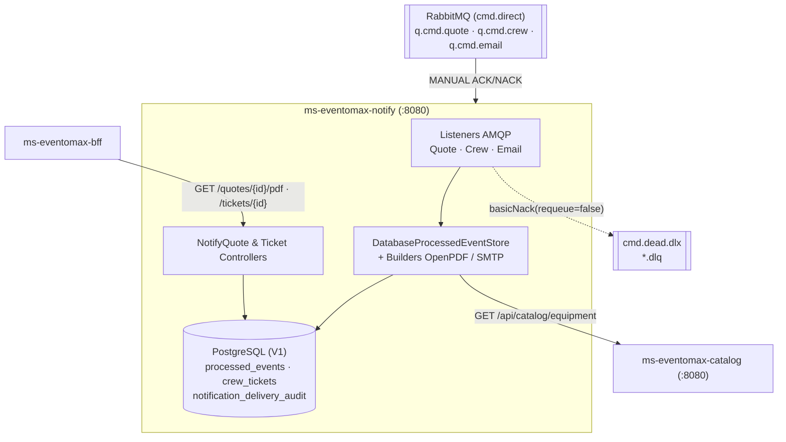

<a href="https://eventomax-production-portal-app.s3.us-east-1.amazonaws.com/index.html">
  
</a>

> **Caso de Estudio 8:** Plataforma B2B de Producción y Montaje de Eventos &nbsp;|&nbsp; **Asignatura:** Desarrollo Cloud Native (`DSY1107`) &nbsp;|&nbsp; **Equipo:** Ignacio Valeria, Benjamín Flores, Benjamín Espinoza

## Propósito del Repositorio

`ms-eventomax-notify` ejecuta el procesamiento asíncrono de comandos AMQP recibidos desde **RabbitMQ** (`cmd.direct`) y la emisión de documentos y notificaciones de **EventoMax**:

- **Generación de Actas de Cierre PDF (`QuoteCommandListener` · `q.cmd.quote`):** Consolida datos de producción, contacto enmascarado del organizador, disponibilidad referencial de equipamiento (`RestCatalogReservationClient`) y trazabilidad vía `ProductionClosureDocumentBuilder`, renderizando un PDF multipágina con **OpenPDF (`2.0.3`)** y persistencia configurable (`LocalFileSystemDocumentStorageService` o `S3DocumentStorageService`).
- **Emisión de Tickets de Cuadrilla (`CrewCommandListener` · `q.cmd.crew`):** Registra órdenes técnicas (`crew_tickets`) cuando una producción avanza a ejecución.
- **Notificaciones por Correo (`EmailCommandListener` · `q.cmd.email`):** Procesa envíos de transición de estado con reintentos acotados (`NotificationRetryConfig`), auditoría en `notification_delivery_audit` y dos proveedores explícitos: `smtp` (`SmtpEmailSender` con `JavaMailSender`) o `logging` (`LoggingEmailSender` para simulación controlada).
- **Confiabilidad Manual ACK/NACK e Idempotencia:** Todos los listeners operan con `ackMode = "MANUAL"`. Los eventos ya registrados en `processed_events` (`DatabaseProcessedEventStore`) reciben `basicAck` sin duplicar PDFs ni correos; errores permanentes se rechazan sin reencolar hacia `cmd.dead.dlx` y las colas `*.dlq`.

## Accesos Relacionados (Demo AWS)

| Recurso | Enlace HTTPS | Credenciales / Uso |
| :--- | :--- | :--- |
| **Portal Web EventoMax** | [Abrir Portal Web](https://eventomax-production-portal-app.s3.us-east-1.amazonaws.com/index.html) | Microsoft Entra ID (descarga de Acta PDF y Crew Ticket) |
| **RabbitMQ Management** | [Abrir RabbitMQ UI](https://7dewsdyt7i.execute-api.us-east-1.amazonaws.com/rabbitmq/) | `eventomax` / `eventomax` (inspección de `q.cmd.*` y `*.dlq`) |

## Endpoints Internos (`expose 8080`)

| Método | Ruta | Consumidor Principal | Descripción |
| :--- | :--- | :--- | :--- |
| `GET` | `/api/notify/quotes/{productionId}/pdf` | `ms-eventomax-bff` (`GET /api/productions/{id}/quote-pdf`) | Entrega el binario `application/pdf` del Acta de Cierre |
| `GET` | `/api/notify/tickets/{productionId}` | `ms-eventomax-bff` (`GET /api/productions/{id}/crew-ticket`) | Consulta el Crew Ticket técnico emitido para la producción |
| `GET` | `/actuator/health`, `/actuator/info` | Interno | Estado de salud AMQP y PostgreSQL |

## Base de Datos (`V1__create_notify_tables.sql`)

- **`processed_events`:** Almacena `eventId` ya procesados para garantizar idempotencia *effectively-once*.
- **`crew_tickets`:** Persiste asignaciones de cuadrilla generadas al pasar a ejecución.
- **`notification_delivery_audit`:** Audita cada intento de notificación (`SMTP` o `SIMULATED_LOGGING`).

## Stack Tecnológico

<table>
  <tr>
    <td align="center" width="20%">
      <br />
      <strong>Java 25 · Boot 4.1.1</strong>
    </td>
    <td align="center" width="20%">
      <br />
      <strong>RabbitMQ MANUAL ACK</strong>
    </td>
    <td align="center" width="20%">
      <br />
      <strong>PostgreSQL · Flyway</strong>
    </td>
    <td align="center" width="20%">
      <br />
      <strong>OpenPDF · AWS S3</strong>
    </td>
    <td align="center" width="20%">
      <br />
      <strong>Docker (640m)</strong>
    </td>
  </tr>
</table>

## Arquitectura del Módulo



## Variables de Entorno y Verificación

| Variable | Ejemplo | Descripción |
| :--- | :--- | :--- |
| `DB_URL` / `DB_USER` / `DB_PASSWORD` | `jdbc:postgresql://<HOST>:5432/postgres?currentSchema=notify` | Conexión PostgreSQL / RDS |
| `SPRING_RABBITMQ_ADDRESSES` | `rabbitmq-1:5672,rabbitmq-2:5672` | Nodos AMQP del clúster RabbitMQ |
| `CATALOG_BASE_URL` | `http://ms-eventomax-catalog:8080` | URL interna para consulta de catálogo en actas |
| `EVENTOMAX_NOTIFY_EMAIL_PROVIDER` | `smtp` o `logging` | Proveedor de correo saliente (`SmtpEmailSender` / `LoggingEmailSender`) |
| `EVENTOMAX_NOTIFY_QUOTE_PROVIDER` | `enterprise` | Generador OpenPDF empresarial (`OpenPdfClosureDocumentGenerator`) |
| `STORAGE_PROVIDER` / `STORAGE_LOCAL_BASE_DIR` | `local` (`/data/quotes`) o `s3` | Persistencia local en volumen o bucket S3 |
| `SMTP_HOST` / `SMTP_PORT` | `mailpit` / `1025` (o relay SMTP) | Host y puerto del servidor SMTP |

```bash
# Suite completa con Testcontainers RabbitMQ y validación OpenPDF
./mvnw -B -ntp verify

# Despliegue Docker (mem_limit: 640m)
docker compose --env-file .env.prod -f docker-compose.prod.yml up -d --build
```
