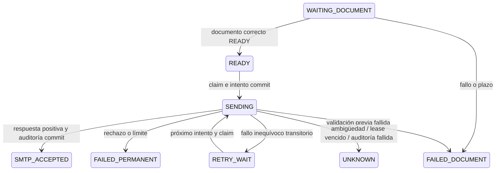

# Fase 2B — coordinación durable de cierre

Base: `develop` en `f7859611a6e515b92c159ca965b9f8c9674c4b62`.
Rama: `feat/notify-phase-2b-durable-closure`.
El plan se presentó antes de modificar código. Este documento describe la implementación
final para revisión; no autoriza migraciones, activación, despliegue o merge.

## Identidad y contratos

El modelo actual tiene un CERRADO terminal por producción. La clave de negocio es
`(production_id, CLOSURE_EMAIL)`; el documento también es único por producción.
Las colas y envelopes de Productions permanecen intactos. Cada comando conserva su
propio eventId; Inbox usa `(consumer, event_id)`. TraceId y correlationId no se usan
como claves de negocio y permanecen en el envelope persistido y las cabeceras SMTP.

Se congela el primer snapshot de cada comando de cierre. Otro UUID del mismo cierre
no genera otra entrega ni reemplaza el documento. Reusar un eventId con otro envelope
o cambiar organizador/destinatario de una intención existente se rechaza, con rollback
del Inbox nuevo y NACK a DLQ. No hay regeneración documental ni reenvío implícitos.
Un futuro contrato que permita reapertura requiere una revisión de cierre compartida;
no debe activarse este modelo para ese contrato sin otro diseño.

El destinatario es el contacto explícito resuelto por el productor confiable del comando.
Notify valida que sea un único mailbox, que esté presente y que coincida con el primer
snapshot; no vuelve a consultar contactos ni inventa un destinatario desde organizerId.
Los permisos del broker y la procedencia confiable siguen siendo precondiciones.

## Persistencia y transacciones

V2 es aditiva: crea `closure_inbox`, `closure_documents`, `closure_deliveries` y
`closure_smtp_attempts`, índices, FK y checks. No cambia V1 ni destruye tablas históricas.
Se ejecuta con Flyway en el esquema Notify; el repositorio usa explícitamente `notify`.
La implementación durable requiere PostgreSQL. H2 prueba la migración portable y los
flujos históricos; los claims/concurrencia se prueban con PostgreSQL real efímero.

| Entidad | Restricción y responsabilidad |
| --- | --- |
| Inbox | PK consumidor/eventId; SHA-256 del envelope tipado para detectar reutilización conflictiva |
| Documento | UUID, productionId único, snapshot, estado, key, tamaño, MIME, SHA-256 y lease |
| Entrega | UUID, clave de negocio única, snapshot de email, documento FK, intentos, plazo y lease |
| Intento SMTP | PK UUID del claim; UNIQUE entrega/número; estado y hash documental adjunto |

`acceptEmail` y `acceptDocument` usan TransactionTemplate REQUIRES_NEW: su retorno implica
commit completado, incluso si el caller tiene otra transacción. Los listeners hacen ACK
después. Los errores de persistencia pasan por los intentos acotados existentes; al agotarse
se conserva el mensaje en la DLQ mediante NACK sin requeue. JSON/type/payload inválidos
conservan ese destino. Un redelivery posterior a un commit sin ACK encuentra la misma Inbox.

Los claims usan `FOR UPDATE SKIP LOCKED` dentro de una transacción corta, un UUID de lease
y una actualización por fila. El statement y la transacción durable tienen límite de 5 s.
No se mantiene una transacción durante generación, almacenamiento ni SMTP.

## Documento empresarial y recuperación

1. QuoteCommandListener confirma la intención persistida; no espera la generación.
2. El worker reclama un documento PENDING/RETRY_WAIT y registra intento/lease.
3. `generateDurableClosure` usa exclusivamente builder y OpenPDF empresarial. No llama
   al fallback legacy y no genera una copia latest como fuente del cierre.
4. El PDF incorpora metadata de productionId, documentId y tipo ENTERPRISE_CLOSURE,
   sin cambiar el diseño. Se verifica estructura, páginas, identidad, tamaño y SHA-256.
5. Se registra primero una key única por documento y lease, hash y tamaño. Una escritura
   posterior a la pérdida del lease queda aislada en su propia key y no puede publicar READY.
6. La escritura es create-if-absent. Local: temp único, FileChannel.force y publicación
   con hard link sin reemplazo. S3: PUT condicional If-None-Match `*`; 412 significa existente,
   no autorización para sobreescribir. Un fallo se propaga y no se convierte en éxito.
7. Se vuelve a leer la key exacta y se verifica contra los metadatos preparados. Solo entonces
   READY se confirma en PostgreSQL con fencing del lease. El registro es la publicación durable.
8. Una caída después de almacenar y antes de READY se recupera verificando la key preparada.
   Si no existe, se prepara otra key; si está corrupta no se adopta. La publicación de un
   generador antiguo queda rechazada por su token. Objetos huérfanos no elegidos no se adjuntan.

Categoría durable: `closures`. La lectura exacta no usa fallbacks de disco histórico.
La descarga HTTP existente busca primero el registro de la producción: READY verificado
devuelve el PDF, PENDING no devuelve un alias antiguo, y un fallo de integridad devuelve 503.
Producciones sin registro durable conservan la descarga histórica anterior. Las rutas y
las comprobaciones de autenticación/propiedad del BFF no se modifican.

El backend local requiere volumen persistente y acceso al mismo filesystem por todos los
workers que compartan esta base de datos. La publicación requiere soporte de hard links;
no se degrada a escritura parcial si falta. El fsync cubre el archivo; no se promete tolerar
la pérdida del disco/volumen. Para varios hosts debe usarse almacenamiento compartido o S3
previamente aprobado. S3 tiene límites de llamada (15 s) e intento (5 s); no se usó AWS en pruebas.

## Entrega, estados y resultado ambiguo

El coordinador enlaza documento READY e intención por producción y organizador. Soporta
ambos órdenes de llegada. Una intención sin contacto válido queda FAILED_PERMANENT.
Un plazo documental agotado, fallo terminal o conflicto de organizador queda FAILED_DOCUMENT.

Antes de invocar transporte se verifica de nuevo documento, checksum, identidad, tamaño,
destinatario y propiedad vigente del claim. SMTP recibe bytes exactos, no un path mutable.
El Message-ID es estable por deliveryId y usa el dominio del remitente configurado.
Cabeceras separadas conservan eventId, traceId, correlationId, deliveryId y checksum.
HTML y texto existentes se reutilizan: solo se afirma acta adjunta tras validar los bytes.
`SmtpEmailSender.send(CERRADO)` bloquea la ruta directa; requiere el transporte durable.

El transporte no escribe auditoría. Después de su retorno, una transacción confirma
entrega, intento y `notification_delivery_audit` como ACCEPTED_BY_SMTP. Si esa transacción
falla, el worker conserva UNKNOWN aunque la causa sea una conexión DB rechazada. Si la
base sigue caída, SENDING queda recuperable como UNKNOWN al vencer el lease.

Reintentos seguros: conexión rechazada antes de transmisión o respuesta SMTP negativa
explícita 4xx. Rechazo 5xx/autenticación son terminales. Timeout, desconexión tras DATA,
resultado parcial o excepción no clasificable son UNKNOWN. Un SENDING expirado no se
reclama otra vez. Una respuesta positiva tardía del mismo intento puede reconciliar su
UNKNOWN a SMTP_ACCEPTED; no inicia una nueva transmisión.

Por defecto hay cinco intentos totales y backoff 1 s, 5 s, 30 s, 2 min con jitter ±20 %.
Los próximos intentos se guardan; no hay polling documental ni sleep prolongado en RabbitMQ.
Una aceptación SMTP no prueba recepción final. Message-ID, Inbox y outbox de trabajos
no garantizan exactly-once físico por SMTP.

## Configuración y operación

| Variable | Default | Efecto |
| --- | --- | --- |
| NOTIFY_CLOSURE_ENABLED | true | Inbox, registro, worker y lector durable |
| NOTIFY_CLOSURE_GENERATION_ENABLED | true | Permite nuevos claims documentales |
| NOTIFY_CLOSURE_DISPATCH_ENABLED | false | Permite nuevos claims SMTP; cerrado por defecto |
| NOTIFY_CLOSURE_LEASE | 2m | Fencing y recuperación de trabajos interrumpidos |
| NOTIFY_CLOSURE_DOCUMENT_WAIT | 15m | Plazo de espera documental por intención |
| NOTIFY_CLOSURE_MAX_ATTEMPTS | 5 | Límite por documento y entrega |
| NOTIFY_CLOSURE_MAX_PDF_BYTES | 10000000 | Límite uniforme de generación, envío y descarga |

Las propiedades se enlazan al arrancar, no son un interruptor dinámico. Desactivar
closure.enabled no constituye un rollback de los trabajos ya persistidos; la ruta SMTP
directa de cierre queda bloqueada y el lector histórico no sustituye al registro durable.
El proveedor logging no implementa el transporte durable y nunca produce SMTP_ACCEPTED.
El proveedor smtp y el contacto autorizado son requisitos para habilitar despacho.

Los logs nuevos usan identificadores y códigos; no imprimen cuerpos, URLs privadas,
credenciales o destinatarios del cierre. El envelope necesario para reconstruir el trabajo
contiene datos personales: mantener RBAC, backup y retención aprobados. No se implementó
purga automática de Inbox, objetos huérfanos ni auditoría en esta fase.

## Activación futura y rollback

Nada de esta sección se ejecutó en producción.

1. Revisar y aprobar código, V2 y resultados aislados. Confirmar la imagen exacta a desplegar.
2. Definir cohorte de cierres nuevos y ventana de corte; drenar/aislar comandos históricos
   antes de iniciar los nuevos consumidores. La auditoría histórica no distingue con certeza
   el estado del email: no permite deduplicar retrospectivamente todos los cierres enviados.
   No reproducir mensajes antiguos ni habilitar cohortes ambiguas sin reconciliación.
3. Aprobar backup y V2 aditiva en Notify. Verificar volumen compartido/conditional writes,
   permisos, límites y proveedor SMTP, conservando credenciales. Esquema y app deben ser coherentes.
4. Desplegar inicialmente con despacho pausado, observar Inbox/READY/fallos y verificar hashes.
   Habilitar una cohorte solo con autorización de despliegue y contacto validado. No ejecutar
   el consumidor antiguo y el durable simultáneamente sobre el mismo flujo.
5. Vigilar antigüedad WAITING_DOCUMENT/READY, leases vencidos, UNKNOWN, intentos agotados,
   fallos de storage y DLQ. Estos estados están persistidos; no se añadieron endpoints públicos
   de administración, reenvío ni dashboard operativo.
6. UNKNOWN necesita evidencia del proveedor y reconciliación operativa autorizada. No hay
   endpoint ni worker que lo reencole automáticamente. No ejecutar UPDATE a READY a ciegas.

Rollback: pausar nuevos despachos y consumidores mediante operación autorizada, esperar
o clasificar claims SENDING, conservar tablas/objetos y drenar/adaptar los trabajos ya ACKeados.
Volver a una imagen antigua por sí solo no recupera esas intenciones ni las nuevas descargas.
Conservar un lector compatible o completar el drenado antes de cambiar la imagen. No borrar
Inbox, intentos, processed_events o DLQ, ni ejecutar una migración destructiva. Antes de
desplegar, basta cerrar este PR para conservar develop/main y producción intactos.

## Evidencias

La matriz y ejecución final están en `NOTIFY-2B-VALIDATION.md`. Las pruebas usan PostgreSQL
y RabbitMQ efímeros y un SMTP local que nunca retransmite correo. No prueban Brevo, S3 real,
hardware perdido, una interrupción real del JVM ni renderizado en Gmail/Outlook. Los failpoints
simulan fronteras de commit, leases y reconstrucción de componentes con la misma base durable.

Referencias: [PostgreSQL SKIP LOCKED](https://www.postgresql.org/docs/18/sql-select.html),
[S3 conditional writes](https://docs.aws.amazon.com/AmazonS3/latest/userguide/conditional-writes.html),
[SMTP RFC 5321](https://datatracker.ietf.org/doc/html/rfc5321).
